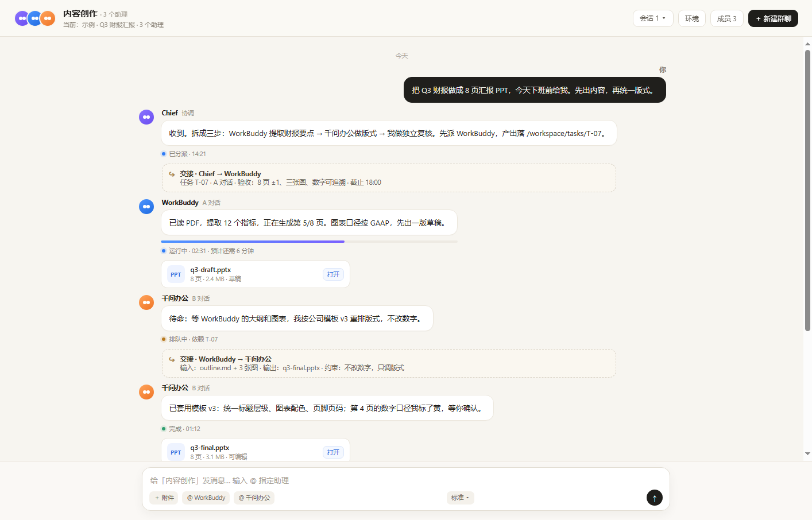
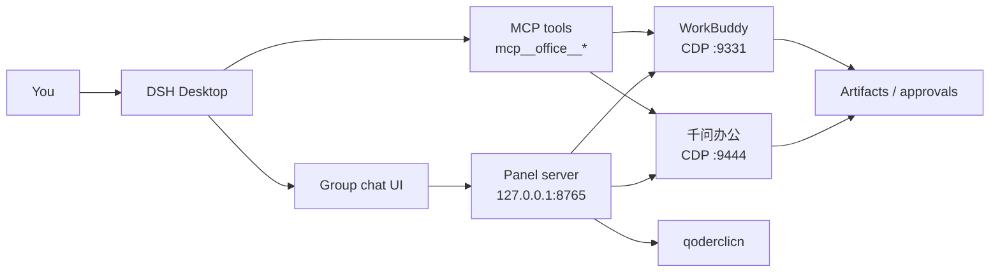
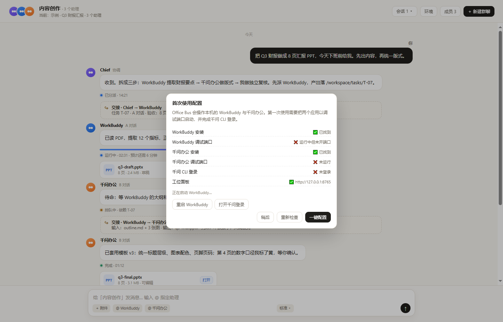
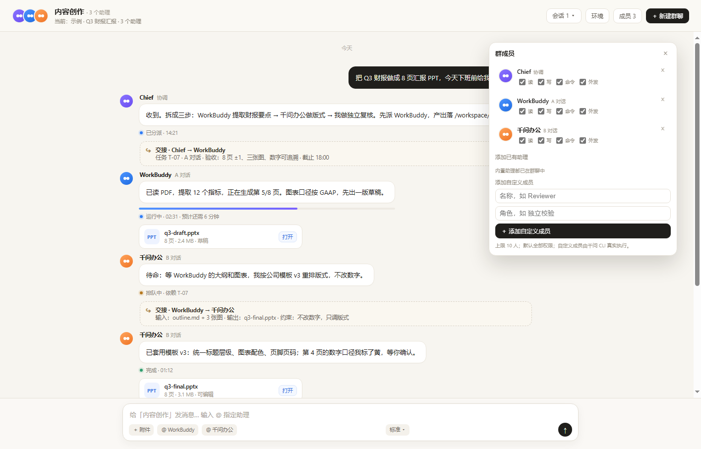
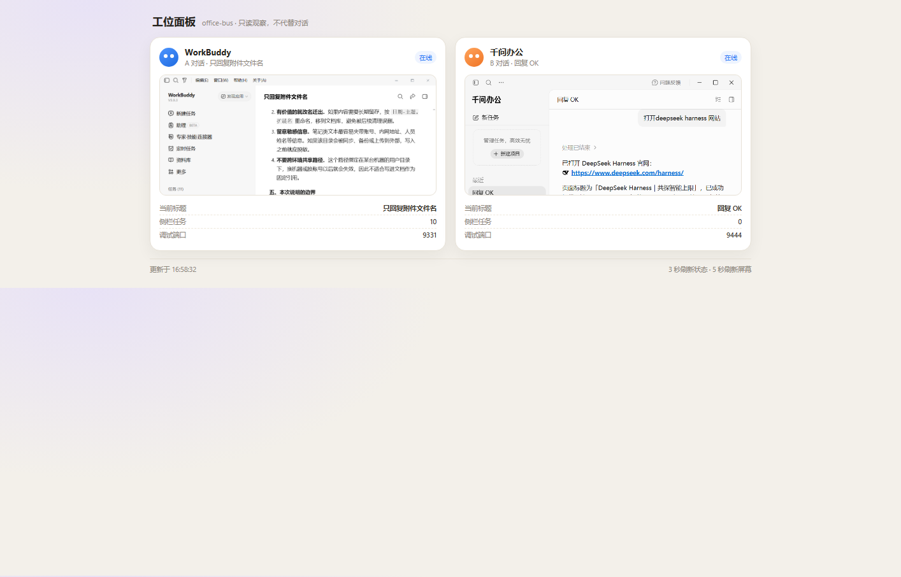

<div align="center">
  
  <h1>Office Bus</h1>
  <p><strong>One group chat. Two desktop agents. Real work.</strong></p>
  <p>用一个 DSH 群聊，调度本机的 WorkBuddy 与千问办公。</p>

  <p>
    <a href="https://dshmarket.com"></a>
    <a href="https://www.npmjs.com/package/dsh-office-bus"></a>
    <a href="LICENSE"></a>
    
  </p>
</div>



**Office Bus** turns **WorkBuddy** and **千问办公** into members of one DSH group chat. You write one instruction, `@WorkBuddy` extracts the source material, `@千问办公` re-lays it out, and a reviewer checks the result — while a live panel shows both desks.

It is **local-first**: no cloud sandbox, no API keys for the office apps, no screen streaming. It drives the apps already signed in on your PC through Chromium DevTools Protocol, and exposes the same operations as `mcp__office__*` tools.

---

## Why

Most agent tools stop at a chat box. Real office work already lives in desktop apps: a report in WorkBuddy, a deck in 千问, a PDF on disk, an approval in a group chat.

Office Bus connects those pieces:

- **One place to command** — a group chat with members, `@` mentions and attachments.
- **Real executors** — WorkBuddy and 千问 are operated as apps, not reimplemented as prompts.
- **Handoff, not copy-paste** — the output of one member becomes the input of the next.
- **Human approval stays human** — publishing, paying and deleting can be gated behind approval cards.

---

## Features

| | |
|---|---|
| 🧠 **Multi-agent group chat** | Chief, WorkBuddy, 千问办公 and custom members in one thread. |
| 🖥️ **Real desktop control** | WorkBuddy `:9331` and 千问 `:9444` over CDP; qoder CLI for custom members. |
| 🔁 **Built-in handoff** | `Chief → WorkBuddy → 千问办公 → Reviewer` with task state and artifacts. |
| 🧑‍💻 **Custom members** | Name + role, executed for real by the qwen CLI. Up to 10 members. |
| 📎 **Files in / out** | Paste a path, drag a file, or upload; artifacts come back as cards. |
| 🛂 **Approvals** | `office_request_approval` / `office_resolve_approval`; pending items surface in the panel. |
| 📊 **Live work panel** | Side-by-side WorkBuddy and 千问 screenshots, current task, queue, artifacts. |
| 🔌 **MCP-native** | Every chat action is also a tool: `office_send`, `office_wait`, `office_artifacts`… |
| 🔒 **Local-only** | Panel binds `127.0.0.1`; no account passwords are stored. |

---

## How it works



The plugin has three parts:

- **Host plugin** — starts the local panel service.
- **Client plugin** — group chat, member panel, `@` chips, attachments, right-side work panel.
- **MCP server** — the same operations as tools, so an agent can drive the office apps without the UI.

---

## Install

### DSH Plugin Market (recommended)

Open **DSH Desktop → Plugins → Discover**, search **Office Bus**, install, then open **Workspace → 对话群聊**.

> If the listing is not live yet, use the local bundle below.

### Local bundle

```powershell
plugin_manager install_bundle { "target": "C:/path/to/dsh-office-bus" }
```

### From source

```powershell
git clone https://github.com/<your-name>/dsh-office-bus.git
cd dsh-office-bus
```

Then install the directory through `plugin_manager` as above (no build step; the package has no npm dependencies).

---

## First run: automatic setup

Open the group chat for the first time. Office Bus checks the machine and shows a setup card:



<sub>示意：检测到 WorkBuddy 未开调试端口、千问未运行、CLI 未登录。</sub>

| State | What the plugin does |
|---|---|
| Installed, not running | **Starts it automatically** with the debug port. |
| Running, no debug port | Shows **Restart WorkBuddy / Restart 千问** — never silently kills an app with unsaved work. |
| 千问 CLI not logged in | Starts `qoderclicn login`, opens the browser authorization page, then polls. |
| Everything ready | Card closes automatically. |

The **环境** button in the header reopens the same checker at any time.

---

## Use it

1. **Workspace → 对话群聊 → ＋ 新建群聊**
2. Type an instruction, optionally `@` a member:

```text
@WorkBuddy 把这份 PDF 提炼成 8 页汇报，先出大纲，数字要能追溯。
@千问办公 按公司模板 v3 重排，不要改数字。
@Reviewer 检查第 4 页的口径，只回复问题清单。
```

3. Add files with **＋ 附件** (paste a local path) or drag them into the composer.
4. Watch progress in the chat; open **工位面板** for both desktops side by side.
5. Switch output mode with **标准 ▾**, and switch threads with **会话 N ▾**.

### Members and permissions



- Add WorkBuddy / 千问 if they are not already in the group.
- Add a custom member with a **name** and **role**; it is executed by the qwen CLI.
- Each member has **读 / 写 / 命令 / 外发** switches.
- Removing a member with a running task asks **停止并移除 / 仅移除 / 取消**.
- At least one member must remain; the limit is 10.

### Work panel



`http://127.0.0.1:8765` is a local, read-mostly view of both desks: current title, queue, debug port, screenshots, and pending approvals.

---

## MCP tools

<details>
<summary><strong>mcp__office__* tool reference</strong></summary>

| Tool | Purpose |
|---|---|
| `office_status` | WorkBuddy port, active thread, sidebar count, recent tasks. |
| `office_launch` | Start WorkBuddy with the debug port (optionally restart). |
| `office_list_threads` | List WorkBuddy conversations. |
| `office_open_thread` | Open a conversation by alias / title. |
| `office_new_thread` | Start a new WorkBuddy task. |
| `office_send` | Send a task; returns a `T-…` task id. |
| `office_wait` | Poll a task for a bounded interval. |
| `office_read_last` | Read the last assistant reply. |
| `office_stop` | Stop the active run. |
| `office_artifacts` | List files produced by a task. |
| `office_tasks` | Recent task records. |
| `office_set_alias` | Bind an alias to a conversation. |
| `office_delete_thread` | Delete a conversation (explicit confirm). |
| `office_request_approval` | Create a pending approval card. |
| `office_resolve_approval` | Record a human decision. |
| `office_approvals` | List pending approvals. |
| `qwen_status` | Check the qoder CLI / login state. |
| `qwen_run` | Run a one-shot qwen CLI task. |
| `qwen_ui_status` | 千问 desktop status. |
| `qwen_ui_list_tasks` | 千问 recent tasks. |
| `qwen_ui_read_last` | 千问 last reply. |
| `qwen_ui_send` | Send a task in the 千问 UI. |

</details>

---

## Configuration

Default config lives in the package (`config.json`); user overrides go to:

```text
~/.dsh/office-bus/data/config.json
```

```json
{
  "port": 9331,
  "panelPort": 8765,
  "workbuddyExe": "C:/Program Files/WorkBuddy/WorkBuddy.exe",
  "qwen": {
    "exe": "C:/.../QwenWorkCN/QwenWorkCN.exe",
    "cli": "C:/.../resources/bin/qoderclicn.exe",
    "gitBashPath": "C:/Program Files/Git/bin/bash.exe"
  }
}
```

| Key | Meaning |
|---|---|
| `port` | WorkBuddy CDP port, default `9331`. |
| `panelPort` | Local panel port, default `8765`. |
| `workbuddyExe` | Path to `WorkBuddy.exe`; auto-detected if omitted. |
| `qwen.exe` | Path to `QwenWorkCN.exe`; auto-detected. |
| `qwen.cli` | Path to `qoderclicn.exe`; auto-detected. |
| `qwen.gitBashPath` | Git Bash used by the qwen CLI on Windows. |
| `home` | Data directory, default `~/.dsh/office-bus/data`. |

Environment override: `OFFICE_BUS_CONFIG=/path/to/config.json`.

---

## Security model

See [SECURITY.md](SECURITY.md) for the full threat model.

- **Local only.** The panel listens on `127.0.0.1`; there is no cloud relay.
- **No credentials.** Office Bus uses the apps you are already signed into; it does not read passwords.
- **Explicit restarts.** Apps running without a debug port are never killed silently.
- **Approvals for side effects.** Publishing, paying and deleting should be gated with an approval card.
- **Permission switches are best-effort.** Custom members can be restricted through read/write/command/external switches and the qwen permission mode; for WorkBuddy and 千问 the restriction is a task-level instruction, not a hard sandbox.

---

## Troubleshooting

| Symptom | Fix |
|---|---|
| WorkBuddy port `9331` not reachable | Open **环境** → **重启 WorkBuddy**, or launch it with the debug port. |
| 千问 port `9444` not reachable | Open **环境** → **重启千问办公**. |
| 千问 CLI not logged in | Open **环境** → **打开千问登录**, finish the browser flow. |
| Panel page does not load | Check `http://127.0.0.1:8765`; another process may own the port. |
| Workspace row missing after DSH upgrade | Reinstall/update the plugin; the row is injected into the session tree. |
| `@WorkBuddy` sends nothing | Confirm WorkBuddy is on the target conversation and the debug port is open. |

---

## Roadmap

- [ ] WeCom / WeChat gateway: send instructions from a real chat.
- [ ] Hard permission isolation for WorkBuddy / 千问.
- [ ] Parallel task scheduling across members.
- [ ] macOS adapters.
- [ ] Conversation export and richer artifacts.

---

## Development

```powershell
node src/mcp-server.js     # MCP over stdio
node src/panel-server.js   # local panel only
node src/doctor.js         # environment check
node src/mcp-smoke.js      # MCP smoke test
npm pack                   # verify the published file list
```

No build step and no npm runtime dependencies. The client is a prebuilt DSH module loader bundle.

---

## Publishing

1. Change `name` / `version` / `repository` in `package.json`.
2. If the package name changes, update `lib/client.js` loader id and `cordis.patch.yml` paths.
3. `npm publish --access public`.
4. Add the plugin to [awesome-dsh-plugin](https://github.com/awesome-dsh-plugin/awesome-dsh-plugin); the market indexes it automatically.

---

## Contributing

See [CONTRIBUTING.md](CONTRIBUTING.md). Keep it local-first, include a screenshot for UI changes, and never commit credentials or personal task data.

## License

MIT © Office Bus contributors
